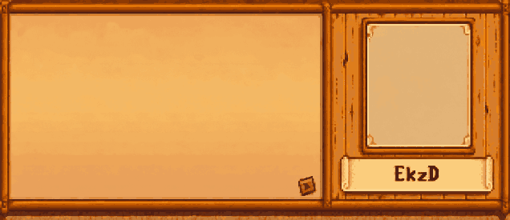
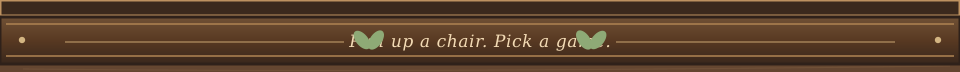

  

---

  

---

  

---

  
  

---

  <!-- The README is the game gallery; games are hosted independently.
       Replace ONE empty slot with a linked 1:1 game image when ready:
       
       Keep all display-image tags adjacent (no whitespace between them),
       and give each cover the same wood-wall frame for continuity. -->
  

  Thanks for stopping by! 🍂

