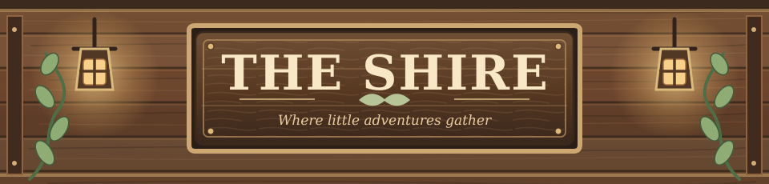
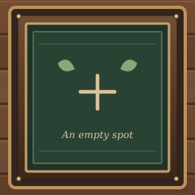

  

---

  

---

  

---

  
  

---

### 🌿 The Shire

  

  <!-- As each browser game goes live, replace one empty-slot image with a linked
       1:1 cover of the same width. Put the cover in assets/shire/covers/ and
       bake a matching wooden frame into the cover artwork if desired:
  
  -->
  
  
  
  

  

  Thanks for stopping by! 🍂

