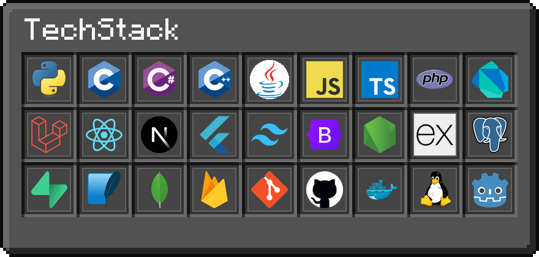

  

---

  

---

  

---

  
  

---

### 🕹️ The Arcade

  
<kbd>INSERT COIN · COMING SOON</kbd>

  No playable games yet. Once they're ready, click a cover to play.

  <!-- Add linked 1:1 game covers here, for example:
  
  -->

  Thanks for stopping by! 🍂

